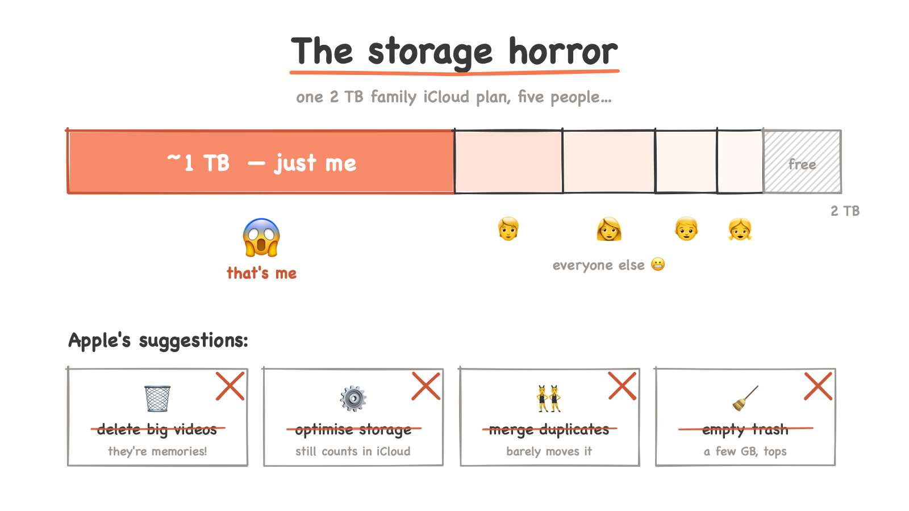
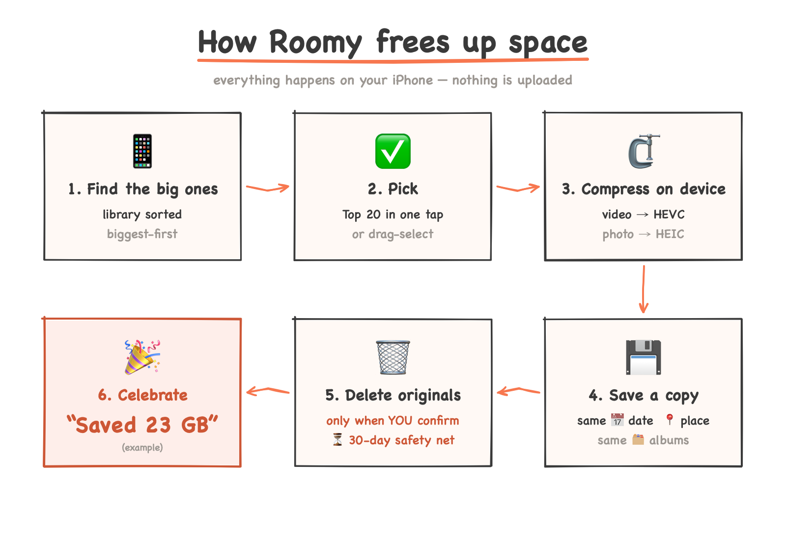
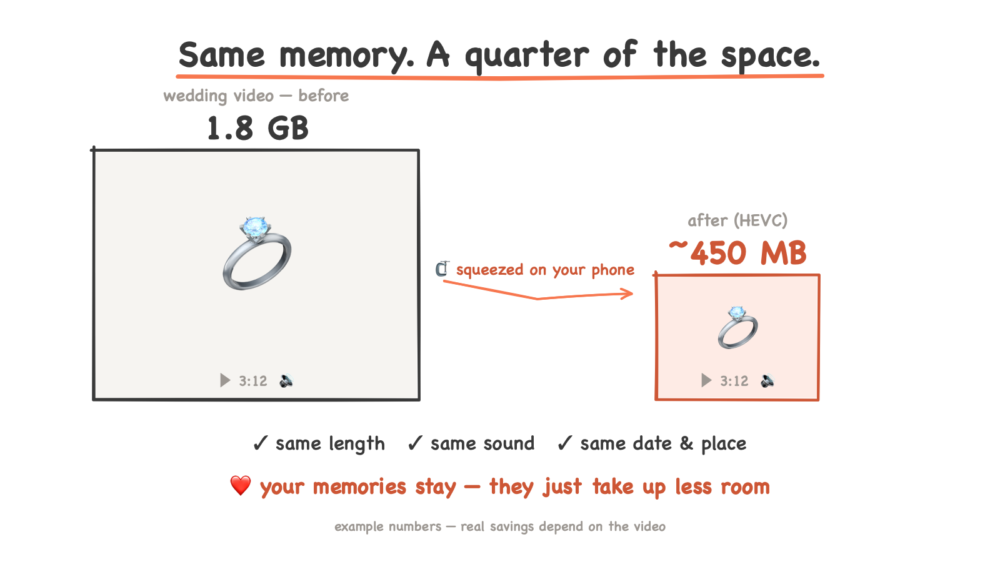
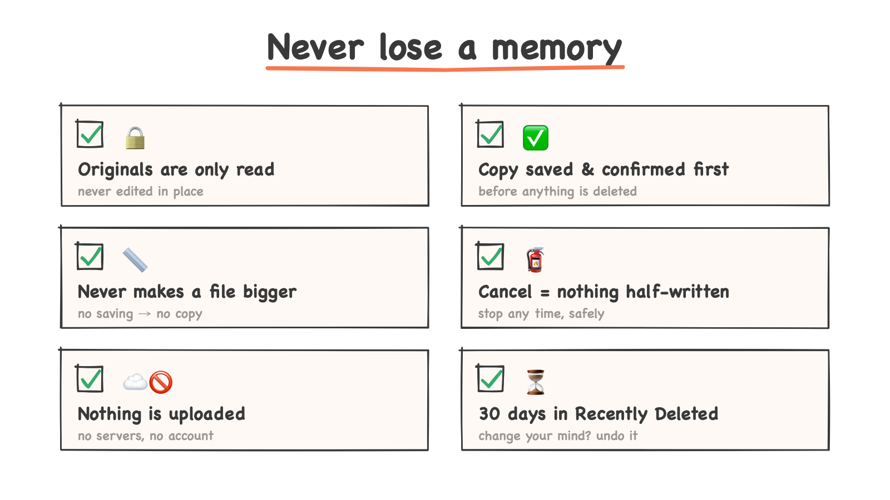

<p align="center">
  
</p>

<h1 align="center">Roomy 🏠📸</h1>

<p align="center"><b>Free up your iPhone. Keep your memories.</b><br>
🆓 Free forever · 📱 Runs on your phone · ☁️🚫 Uploads nothing · 💍👶 Keeps every memory</p>

Roomy finds the biggest videos and photos on your iPhone and makes them smaller, without throwing them away. It runs entirely on your phone, uploads nothing, and costs nothing.

---

## 📱 The Day My Brother Said "Do Something"

It started with a notification. 📱

Not an alarm. Not a warning from Apple. Just my brother, on an ordinary day, typing something that changed how I looked at my phone forever.

> **Bro:** Hey bro, you've used almost 1 TB of storage, and together we're using almost 2 TB! That's insane! We will run out of space — do something, my engineer! 😱

I read it twice.

Our family shares one 2 TB iCloud+ plan.

<p align="center"></p>

Five people. And I, alone, was sitting on almost half of it.

The number kept climbing. 💾

---

## The ticking clock ⏳

I'm a TPM. Problems with deadlines are my day job. So I did what any sensible person does: I followed the instructions.

- **Delete large videos?** Tried it.
- **Optimise iPhone Storage?** Turned it on.
- **Merge duplicates?** Done.
- **Empty Recently Deleted?** Emptied.

Nothing worked for me. The bar barely moved. And every day, the family plan crept closer to full.

So I opened my gallery to decide what had to go.

That's when it got quiet.

---

## What was hiding in there ❤️

It wasn't junk. It was my whole life.

The day I met my partner, the girl who is now my wife. Our dates. Our engagement. 💍 Family events, religious functions, our marriage. Trips we took together. And then our baby. 👶 Every first.

One single family ceremony video was **1.8 GB**. My WhatsApp folder alone held **928 videos taking 6.2 GB**.

The "fix" was asking me to delete *these*?

No. Not one of them.

---

## The turn 🔍

Then the engineer in me noticed something.

Most of these space-hogging videos were stored in an older format, **H.264**. My iPhone already supports **HEVC**, which takes roughly half the size for the same picture.

The memories weren't too big. They were just stored in a heavy format.

I tested it on that WhatsApp folder. Compressing just the biggest 318 of those videos gave back **1.8 GB**, with the same resolution, same length, same sound.

Nothing lost. Just space returned.

---

Everyone hits this wall eventually. And when you do, you shouldn't have to choose between your memories and your storage, or pay more every month forever.

So I built **Roomy**. 🚀

---

## ✨ What Roomy does

<p align="center"></p>

1. **Shows your library largest-first**, as thumbnails, so the real space-wasters are at the top. A "biggest wins" card says things like *"Your 20 largest videos: 14.2 GB — about 9 GB could be freed"* and selects them in one tap. Sort (largest or newest), size and "hide already compressed" are always visible.
2. **Lets you pick many at once.** Top 25, 50 or 100, "everything over 1 GB", tap, or press and drag across several. A running total shows how much space you're about to free.
3. **Compresses them on your phone.** Videos go to HEVC at a size you choose; photos go to HEIC. Very large originals are scaled down sensibly. 4K becomes 1080p, 60 fps becomes 30 fps (slow motion is left alone).
4. **Keeps what matters.** The date and time, location, favourites, hidden status and albums are copied to the compressed version, so it sits in exactly the same place in your timeline.
5. **Saves the compressed copy as a new item** in Photos. Your original is not touched.
6. **Lets you delete the originals afterwards, all at once — only when you're ready.** iOS asks you to confirm, and deleted items stay in *Recently Deleted* for 30 days, so you can change your mind.
7. **Keeps going in the background** while you use your phone for other things, and picks up where it left off if the app is closed.
8. **Keeps score honestly.** A card at the top shows how much space Roomy has saved you, counting only originals you actually deleted. Space that is ready to free but not yet deleted is shown separately, so the number never overclaims. The total is stored on your phone only, so reinstalling the app resets it.

## 🙅 What Roomy does not do

- It does **not upload anything**. There is no server. There is no account.
- It does **not delete anything on its own**. Deleting originals is always your decision, and always confirmed by iOS.
- It does **not cost anything**. No subscription, no in-app purchase, no ads.

## 📲 Install it yourself, for free

Roomy is not on the App Store. You install it from this source code using Apple's own free tools. You do **not** need a paid Apple Developer account.

### What you need

- A **Mac** (Apple silicon or Intel) running a recent macOS
- **Xcode** — free from the Mac App Store
- Your **iPhone** and its USB cable
- Your normal **Apple ID** (the one you already use on your iPhone is fine)

### Steps

**1. Install Xcode and the project tools**

Install Xcode from the Mac App Store and open it once so it can finish setting up. Then open the Terminal app and run:

```bash
# Homebrew, if you don't have it yet: https://brew.sh
brew install xcodegen
```

**2. Download Roomy**

```bash
git clone https://github.com/deepeshchang/roomy.git
cd roomy
```

**3. Make it yours**

App identifiers must be unique per developer, so open `project.yml` in any text editor and change two things:

- `PRODUCT_BUNDLE_IDENTIFIER: com.deepeshchang.VideoCompressor` → something of your own, e.g. `com.yourname.roomy`
- Signing team: leave `DEVELOPMENT_TEAM` blank and pick your team inside Xcode in step 5.

Then generate the Xcode project:

```bash
xcodegen generate
open VideoCompressor.xcodeproj
```

**4. Sign in to Xcode with your Apple ID**

Xcode → **Settings…** → **Accounts** → **+** → **Apple ID**. This creates a free "Personal Team" for you.

**5. Pick your team**

In Xcode, click the blue **VideoCompressor** project icon at the top of the left sidebar → select the **VideoCompressor** target → **Signing & Capabilities** → set **Team** to your Personal Team.

**6. Prepare your iPhone**

- Connect it to your Mac with the cable and tap **Trust** on the phone.
- On the iPhone: **Settings → Privacy & Security → Developer Mode → On**. The phone restarts; confirm when asked.

**7. Run it**

At the top of the Xcode window, choose your iPhone as the destination and press **▶ Run** (or ⌘R).

The first time, your iPhone will refuse to open the app because it doesn't recognise you as a developer yet. On the iPhone go to **Settings → General → VPN & Device Management**, tap your Apple ID under *Developer App*, and tap **Trust**. Then open Roomy.

### The one catch with a free account

Apps installed with a free Apple ID **expire after 7 days**. Roomy simply stops opening. Your photos and videos are not affected in any way. To renew, connect your phone and press **▶ Run** in Xcode again — it takes under a minute.

(A paid Apple Developer account removes this limit. You don't need one to use Roomy.)

## 💡 Using Roomy well

<p align="center"></p>

- **Start small.** Run a batch of 5–10 the first time, open a couple in Photos and compare, then go big.
- **Plug in.** iOS gives background work much more time when the phone is charging. Big batches finish far more reliably on the charger.
- **Pick a quality that suits you.** *Balanced* is right for most people. Choose *High quality* for videos you'll watch on a TV; *Maximum space* for clips you only want to keep. Roomy never makes a file bigger: anything that wouldn't shrink is skipped and marked *Already small*.
- **Empty Recently Deleted** once you're happy. Until then, iOS still counts the originals against your storage.

## 🛡️ Is it safe?

<p align="center"></p>

Roomy was built with one rule above all others: **never lose a memory.**

- Originals are only ever read, never modified.
- A compressed copy is saved and confirmed in Photos *before* the option to delete its original even appears.
- If a compression is cancelled or fails, the half-finished file is removed and the original is untouched.
- Deletion goes through iOS's own confirmation and into Recently Deleted for 30 days.

Still — it's your library. Keep a backup (iCloud Photos or a copy on your computer) before deleting originals of anything irreplaceable.

<sub>Roomy is provided as-is, without warranty of any kind. The author is not liable for any data loss, storage issues, or other damages arising from its use. Use at your own risk.</sub>

## 🔧 Under the hood

For the curious:

- **SwiftUI**, **Swift 6** with strict concurrency, iOS 18 and later
- **AVFoundation** (`AVAssetReader` / `AVAssetWriter`) for video, using the phone's hardware HEVC encoder
- **ImageIO** for HEIC photos
- **PhotoKit** for reading the library and saving copies
- **BackgroundTasks** (`BGContinuedProcessingTask`) for long batches
- **No third-party code at all.** Every line runs on Apple's own frameworks.

Run the tests:

```bash
./run-tests.sh
```

## 📜 Licence

MIT — use it, change it, share it.
